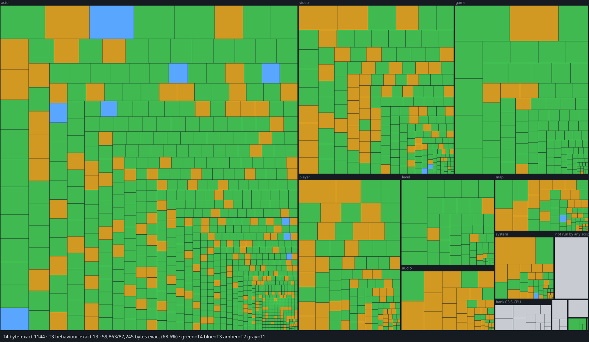
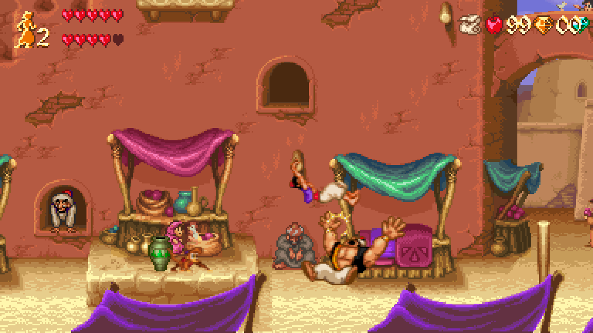
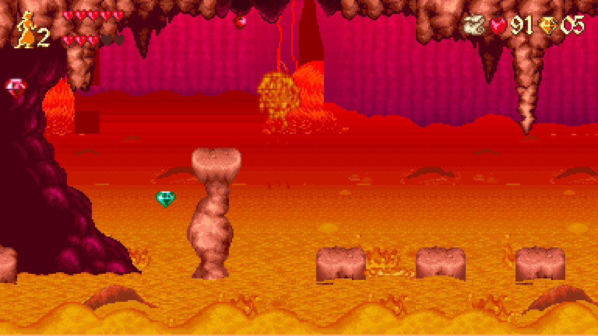
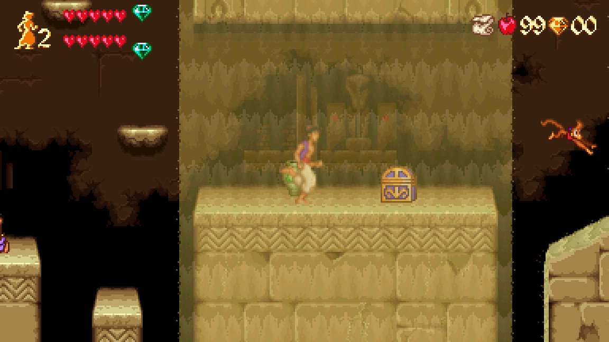
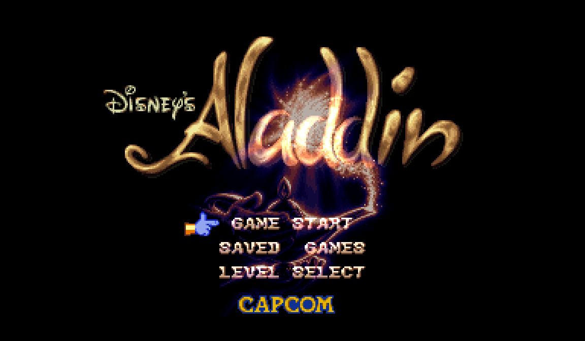
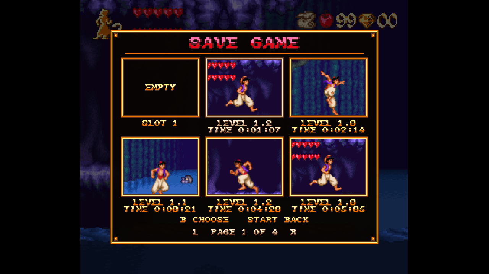
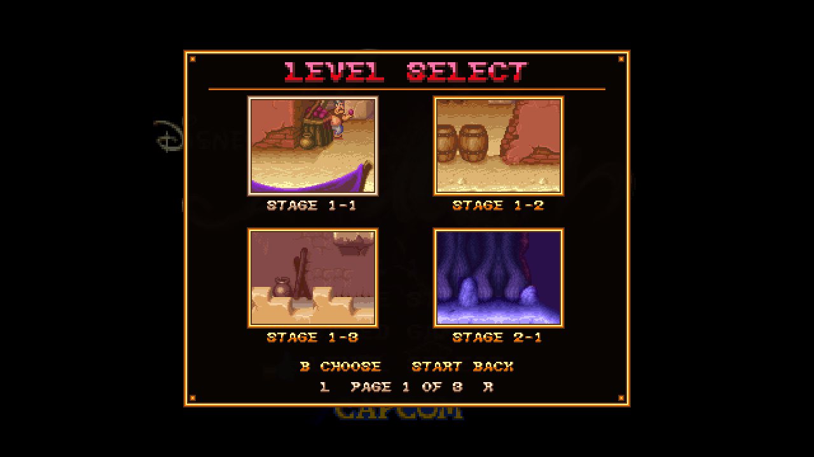

# Aladdin (SNES) decompilation

## Bring your classic game to a new generation

**Jeffrey Wilbur, Strut B, LLC** ·
[retro@strutb.com](mailto:retro@strutb.com)

If you hold the rights to a classic game, I would love to help it live
again. This repository shows what I do: I take a shipped cartridge back
to readable, commented source that rebuilds the original ROM byte for
byte, prove every routine behaves exactly as the original did, and then
run that source natively on today's hardware, with no emulation of any
processor. Here the first two are done, for every byte of the game's
code; the native game runs on Linux and is checked against the original
(docs/aladdin/native/FINAL.md says how far). From there a
game can grow: modern frame rates, widescreen, and builds for macOS,
Windows, Linux, iPhone, iPad and Android, all without losing the game
your players remember.

- **Preserve** it: source you own and can read, maintain and build on,
  recovered from the code that shipped, checked against the original at
  every step.
- **Remaster** it: modern frame rates, screens and controls, on the
  platforms your audience plays on today, with the feel of the original
  intact.
- **Reach new players**, and give your longtime fans the version they
  always pictured.

If you have a game you would like to see again, write to me at
[retro@strutb.com](mailto:retro@strutb.com).

## Aladdin

A bit-exact decompilation of Aladdin (USA) for the Super NES: symbolic,
commented 65816 and SPC700 assembly that rebuilds the ROM byte for byte,
and C for every routine, proven behaviour exact against the running
original. The C is written as C: locals, loops and tables, setting only the
registers and flags the original leaves visible at its exit, at a yield or
to a callee (`src/aladdin/include/native.h`). The sound driver's C also makes
the SPC700's memory accesses in the original's order, as lockstep requires.
The ROM is not included; `reference/aladdin/` holds your own copy.

Standard, layout and tools: [docs/aladdin/DECOMP.md](docs/aladdin/DECOMP.md).
Plan and status: [docs/aladdin/PLAN.md](docs/aladdin/PLAN.md). Findings:
[docs/aladdin/HANDBOOK.md](docs/aladdin/HANDBOOK.md).

## Progress

<!-- PROGRESS:BEGIN: generated by tools/aladdin/progress.py; do not edit by hand -->
_Snapshot 2026-11-21._

```
M1  Behaviour exact (T3 + T4)
    ████████████████████████████████████████  100.0%   92,250 / 92,250 B of the game's code
M2  Byte exact (T4)
    ████████████████████████████████████████  100.0%   92,250 / 92,250 B of the game's code
```

The bars measure the whole game's S-CPU and SPC700 code, 92,250 B: 92,119 B the scripts have run and 131 B the [routine census](docs/aladdin/ROUTINE_CENSUS.md) finds that no script has run yet. Certified so far: 1722 routines behaviour exact, 1722 of them byte exact.

| Processor | M1: behaviour exact | M2: byte exact |
|---|---|---|
| **S-CPU (65816)** | `████████████████████` 100.0%: 89,897/89,897 B | `████████████████████` 100.0%: 89,897/89,897 B |
| **SPC700 (sound)** | `████████████████████` 100.0%: 2,353/2,353 B | `████████████████████` 100.0%: 2,353/2,353 B |
<!-- PROGRESS:END -->

The bars read 100.0% at ledger `bdf23ac7`. The last 91 B were two routines nothing in the ROM calls, `83:FBB5` and
`83:FC23`; they are dead code, and by the decomp's standard dead code is run by a script and certified like the rest,
not left out. 139 B in 22 ranges are exempt by proof, each with its proof in its routine's header. The numbers in the
block above are the gate runner's.



<!-- PROGRESS-DETAIL:BEGIN: generated by tools/aladdin/progress.py; do not edit by hand -->
**What the bars measure.** Bytes of code, not routines. The denominator is
every S-CPU and SPC700 code byte of the game, 92,250 B: the 92,119 B the scripts
have run and the 131 B the routine census (`tools/aladdin/census.py`) finds
by following the code statically (calls, jumps, tables, handler pointers,
task entries, orphans) where no script has gone. The numerator is the code
bytes inside routines whose C is certified behaviour exact (T3) or whose
assembly is also byte exact (T4), for M1, and T4 only for M2. 0 routine(s)
are in the tree but not yet certified (T2).

**Why not routines.** A routine count keeps growing as the work goes on:
every entry point filed in C or reached by a new script splits code already
counted into more routines (the census now counts about 1,728, 1,727 of them
named), while the bytes stay put: tracing a new script moves bytes from
"found" to "run" and barely changes the total. Of the
ROM's 1,310,720 B, the scripts have run 89,766 B as code and read 1,049,790 B as data;
171,164 B have not been touched by any script. The SPC700 (sound CPU) runs
code the S-CPU uploads from ROM; the 2,353 B of it the scripts have run are
counted (folded back from APU RAM onto the uploaded ROM bytes, `tools/aladdin/spcmap.py`);
what no script has run there is not counted yet.

**Byte-exact rebuild.** Independently of the tiers, the whole ROM already
rebuilds byte for byte from source: filed, commented assembly where it
exists and the raw intake for everything else (`tools/aladdin/image.py`).
<!-- PROGRESS-DETAIL:END -->

## The native game: Aladdin Remastered

`native/aladdin` is the whole game running natively on
[nativeshvc](https://github.com/jeff-strutb/nativeshvc), a native engine that provides what the Super NES provided
with zero emulation: no processor instructions run, and there is no imitated PPU, DMA, sound chip or bus. The game is
ordinary typed C written from the certified decomp, routine by routine, and reaches the engine only through its calls
(`nshvc_*`). Its logic is the original's; everything below is added round it.

| <br>Stage 1-1 at 16:9: more of the level, not a wider lens | <br>Stage 3-1 at 16:9 |
|---|---|
| <br>Stage 5-1 at 16:9 | <br>The title, with saved games and level select |
| <br>Save games: the exact moment, with its picture | <br>Level select: levels not yet beaten are dimmed |

### What the remaster adds

- **Widescreen at any shape, 4:3 to ultrawide.** A wider window shows more of the level, filled past the level's edges
  from its own art. Play stays in the original 256 x 224 frame: every trigger keeps its original distance. The view
  follows the window at once on a resize or a switch to full screen. ([VIEW.md](docs/aladdin/native/VIEW.md))
- **Smooth motion at any refresh rate.** The logic is the original's 60 Hz; every picture is eased between updates with
  places between pixels, and the fades, wipes and Mode 7 are eased between their steps.
  ([FRAMERATE.md](docs/aladdin/native/FRAMERATE.md))
- **Runahead.** The picture shows a press one update sooner, at about 0.03 ms a tick; the real game state is untouched.
- **Save games.** 24 slots, each the exact moment with a 1:1 picture of it; save from the pause menu, load from there or
  the title. ([SAVES.md](docs/aladdin/native/SAVES.md))
- **Level select.** All 19 levels with their pictures; the ones you have beaten can be started.
  ([LEVELSELECT.md](docs/aladdin/native/LEVELSELECT.md))
- **A pause menu** in the game's own lettering: controller and key remapping, full screen, quit.
  ([PAUSE.md](docs/aladdin/native/PAUSE.md))
- **Portable.** Options, saves and progress live in a folder beside the game.
- **macOS (Metal), Windows (Direct3D 12) and Linux (Vulkan)** from one source.
  ([BUILD.md](docs/aladdin/native/BUILD.md))

In their place, the original's password screens and options screen are gone
([DEPARTURES.md](docs/aladdin/native/DEPARTURES.md) lists every departure from the original).

### What nativeshvc does for it

- **Draws the SNES's picture natively:** sprites, tile layers, Mode 7, per-line effects, windows and colour maths, as
  calls a game makes, on Metal, Direct3D 12 and Vulkan.
- **Goes past the console where the game asks:** a view of any size, places between pixels, a brightness between the 16
  levels, any number of sprite palettes, whole-level maps.
- **Runs the game's clock and the display's apart:** 60 Hz updates, pictures at the display's rate, shown a refresh
  sooner.
- **Mixes the sound, takes keys and controllers, and keeps the save folder.**

### Checked

- **Against the original:** 18 plays replayed on the original, one logic frame per native update, identical in the
  player and the actor list ([FINAL.md](docs/aladdin/native/FINAL.md)).
- **Nothing added changes the game:** at 256 x 224, the boot and 20 plays are compared update by update with the game
  before the remaster's work. 15 runs are identical; 6 differ only from where the removed password screen began.
- **Runahead and saves:** the real game state is identical with runahead on and off (21 runs); a save loaded in another
  run gives identical traces (6 cases), with runahead off and on.
- **Wide views:** at 288, 384 and 512 wide every play runs to its end and no trigger fires past its original distance.

How each check is run: [CHECK.md](docs/aladdin/native/CHECK.md).

### Not done

- The two boss levels (16 and 17) are proven by patched boss health and one real stomp each, not won in full by keys.
- The animations' pictures keep the original's timing: no in-between art has been made.
- The sound has not been judged by ear, and the engine's mix is not sample-exact.
- A few seams remain where a level's edge cannot be filled from its own art.
- Nothing is packaged for release; how the remaster plays in a window is still being judged.

## The Decompilation Standard

The purpose of a decompilation, as opposed to a recompilation, is
preservation: recovering the game itself, as written, in a form that outlives
the original hardware and media. Playability and portability are welcome side
effects, not the direct goal. This game was written by hand in assembly, so
there is no original compiler to match. The standard has two proofs instead:
the symbolic assembly must rebuild the original ROM byte for byte, and every
routine's C must give exactly the original's outputs for its inputs, checked
call by call and again with whole play sessions run in step with the original.
A bit-exact match is 100% reliability that the source is accurate to the
original, ensuring preservation for future generations.

## Project Purpose

A decompilation of **Aladdin** (SNES, 1993): every routine rewritten as
readable C, documented with what it does and how, filed by what it is for,
and proven to behave exactly like the original; and the whole ROM rebuilt byte
for byte. Progress is measured only by those two proofs; playability is a
consequence, never a reason to reorder the work.

## Game background

Capcom released *Aladdin* for the Super NES in 1993, a platform game based on
Disney's 1992 film. It is a different game from the Aladdin made for the Sega
Genesis the same year. The cartridge is 1.25 MB of ROM with no coprocessor and
no cartridge RAM. The game runs on two processors: the SNES CPU (a 65816) runs
the game logic, and the SPC700 sound CPU plays the music and effects from a
program the main CPU uploads. The retail ROM has no compiler footprint: both
programs were written by hand in assembly. Its tasks and actors are
coroutines that wait in the middle of a routine and resume there on a later
frame ([docs/aladdin/TASKS.md](docs/aladdin/TASKS.md),
[docs/aladdin/ACTORS.md](docs/aladdin/ACTORS.md)).

## Build

```bash
./setup.sh
python3 tools/aladdin/build.py
python3 tools/aladdin/image.py
python3 tools/aladdin/gate.py
```
