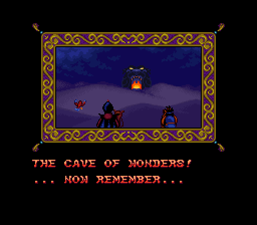
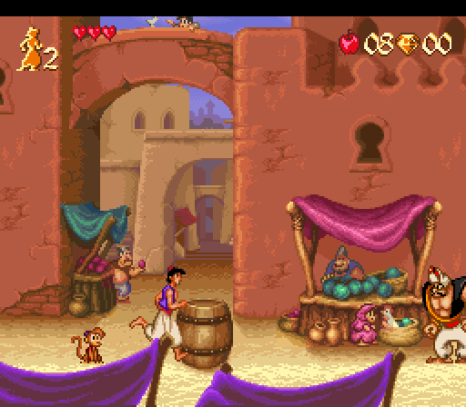
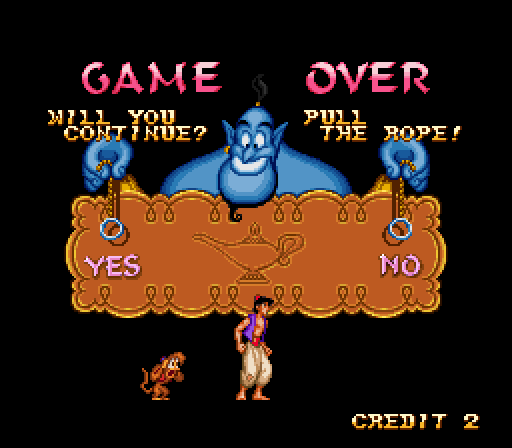

# Aladdin (SNES) decompilation

## Bring your classic game to a new generation

**Jeffrey Wilbur, Strut B, LLC** ·
[retro@strutb.com](mailto:retro@strutb.com)

If you hold the rights to a classic game, I would love to help it live
again. This repository shows what I do: I take a shipped cartridge back
to readable, commented source that rebuilds the original ROM byte for
byte, prove every routine behaves exactly as the original did, and then
run that source natively on today's hardware, with no emulation of any
processor. Here the first two are done, for every byte of the game's
code; the native game runs on Linux and is checked against the original
(docs/aladdin/native/FINAL.md says how far). From there a
game can grow: modern frame rates, widescreen, and builds for macOS,
Windows, Linux, iPhone, iPad and Android, all without losing the game
your players remember.

- **Preserve** it: source you own and can read, maintain and build on,
  recovered from the code that shipped, checked against the original at
  every step.
- **Remaster** it: modern frame rates, screens and controls, on the
  platforms your audience plays on today, with the feel of the original
  intact.
- **Reach new players**, and give your longtime fans the version they
  always pictured.

If you have a game you would like to see again, write to me at
[retro@strutb.com](mailto:retro@strutb.com).

## Aladdin

A bit-exact decompilation of Aladdin (USA) for the Super NES: symbolic,
commented 65816 and SPC700 assembly that rebuilds the ROM byte for byte,
and C for every routine, proven behaviour exact against the running
original. The C is written as C: locals, loops and tables, setting only the
registers and flags the original leaves visible at its exit, at a yield or
to a callee (`src/aladdin/include/native.h`). The sound driver's C also makes
the SPC700's memory accesses in the original's order, as lockstep requires.
The ROM is not included; `reference/aladdin/` holds your own copy.

Standard, layout and tools: [docs/aladdin/DECOMP.md](docs/aladdin/DECOMP.md).
Plan and status: [docs/aladdin/PLAN.md](docs/aladdin/PLAN.md). Findings:
[docs/aladdin/HANDBOOK.md](docs/aladdin/HANDBOOK.md).

## Progress

<!-- PROGRESS:BEGIN: generated by tools/aladdin/progress.py; do not edit by hand -->
_Snapshot 2026-11-21._

```
M1  Behaviour exact (T3 + T4)
    ████████████████████████████████████████  100.0%   92,250 / 92,250 B of the game's code
M2  Byte exact (T4)
    ████████████████████████████████████████  100.0%   92,250 / 92,250 B of the game's code
```

The bars measure the whole game's S-CPU and SPC700 code, 92,250 B: 92,119 B the scripts have run and 131 B the [routine census](docs/aladdin/ROUTINE_CENSUS.md) finds that no script has run yet. Certified so far: 1722 routines behaviour exact, 1722 of them byte exact.

| Processor | M1: behaviour exact | M2: byte exact |
|---|---|---|
| **S-CPU (65816)** | `████████████████████` 100.0%: 89,897/89,897 B | `████████████████████` 100.0%: 89,897/89,897 B |
| **SPC700 (sound)** | `████████████████████` 100.0%: 2,353/2,353 B | `████████████████████` 100.0%: 2,353/2,353 B |
<!-- PROGRESS:END -->

The bars read 100.0% at ledger `bdf23ac7`. The last 91 B were two routines nothing in the ROM calls, `83:FBB5` and
`83:FC23`; they are dead code, and by the decomp's standard dead code is run by a script and certified like the rest,
not left out. 139 B in 22 ranges are exempt by proof, each with its proof in its routine's header. The numbers in the
block above are the gate runner's.


<!-- PROGRESS-DETAIL:BEGIN: generated by tools/aladdin/progress.py; do not edit by hand -->
**What the bars measure.** Bytes of code, not routines. The denominator is
every S-CPU and SPC700 code byte of the game, 92,250 B: the 92,119 B the scripts
have run and the 131 B the routine census (`tools/aladdin/census.py`) finds
by following the code statically (calls, jumps, tables, handler pointers,
task entries, orphans) where no script has gone. The numerator is the code
bytes inside routines whose C is certified behaviour exact (T3) or whose
assembly is also byte exact (T4), for M1, and T4 only for M2. 0 routine(s)
are in the tree but not yet certified (T2).

**Why not routines.** A routine count keeps growing as the work goes on:
every entry point filed in C or reached by a new script splits code already
counted into more routines (the census now counts about 1,728, 1,727 of them
named), while the bytes stay put: tracing a new script moves bytes from
"found" to "run" and barely changes the total. Of the
ROM's 1,310,720 B, the scripts have run 89,766 B as code and read 1,049,790 B as data;
171,164 B have not been touched by any script. The SPC700 (sound CPU) runs
code the S-CPU uploads from ROM; the 2,353 B of it the scripts have run are
counted (folded back from APU RAM onto the uploaded ROM bytes, `tools/aladdin/spcmap.py`);
what no script has run there is not counted yet.

**Byte-exact rebuild.** Independently of the tiers, the whole ROM already
rebuilds byte for byte from source: filed, commented assembly where it
exists and the raw intake for everything else (`tools/aladdin/image.py`).
<!-- PROGRESS-DETAIL:END -->

## The native game: Aladdin Remastered

`native/aladdin` is the game on [nativeshvc](https://github.com/jeff-strutb/nativeshvc),
a native engine, with Linux as the first platform. Each `update` is one 60 Hz
frame of the original's work; `draw` describes the picture from the game's
state. The game's C reaches the engine only through its calls (`nshvc_*`): no
register-shaped state, no translation layer and no imitated PPU, DMA, sound
chip or bus. The engine runs no processor instructions. The plan, its
decisions and its progress are in
[docs/aladdin/native/PLAN.md](docs/aladdin/native/PLAN.md); building it is in
[docs/aladdin/native/BUILD.md](docs/aladdin/native/BUILD.md).

The decomp's C (`src/aladdin`) is the certified record of what each routine
does. The native game is written from it, routine by routine, as ordinary
typed C: named state in place of memory addresses, explicit states in place
of routines that pause, and typed readers in place of cartridge addresses.
The game's logic is the original's, so a wrong value or a misplaced actor is
a bug; recordings of the original are kept to find such bugs.

### Not done

What was proven and what was not, number by number, is in [docs/aladdin/native/FINAL.md](docs/aladdin/native/FINAL.md).

- **Played by keys.** Levels are numbered from 0 here (level 0 is part 0 stage 0; 19 levels in all). A developer's player
  (`native/checks/plays/`, replayed from power-on with the level select) took 16 levels from start to their real exit (0, 1,
  2, 4 to 15 and 18) and level 3 from start to its scene, STAGE 1 CLEAR and story card. Level 9 ends at the Genie's Break
  Time by a real level end. All seven passwords were accepted by keys (parts 1 to 7). The continue screen was reached by
  play. The two boss levels, 16 (Jafar's first form) and 17 (the snake), are **not won in full**: by Jeff's decision each was
  proven by patched boss health and one real stomp by keys, then the defeat, the level end, the next screens, the ending's
  story, the credits and "The End" ran.
- **Proven against the original.** 18 plays (every level but 18) were replayed on the original, one logic frame per native
  update, and are identical (the player's x, y and health, the actor list's kind, x and y) to the update FINAL.md gives for
  each, from 5,877 to 10,893; level 17 with the patched health is identical from 3936 to 7301 and through the finale. The
  ending was compared by cues and frames in two runs of the original: cues equal, scenes 10 to 52 frames shorter native.
  The every-kind table covers 133 kinds against 244 coverage scripts and the stage plays; 8 kinds are never met by a
  recording, the others are exact where a recording follows them, and kind $9E (20 fields) is the open row the later work
  left. Screen effects: the title ribbon, circle wipe, iris, text bands and effects 8, 10, 11 and 12 compared; effects 3, 4 and
  kind $69's circle looked at only; effect 9 is never on screen. Sound: the driver only (41 runs, 330,680 ticks, 0 differ).
- **Not done.** Windows is cross-built and never run; macOS is not built; nothing is packaged. The sound has not been judged by
  ear and the engine's mix is not sample-exact. Neither boss was won in full, and levels 16 and 17 have no play to their
  exit by keys. The compare tool cannot cross a restart or a continue screen. Level 18's play has no comparison listed.
  Kinds that no recording can follow ($44, $84's start, $5F's start, $5C's path, $22's and $87's second entries, $64, $9B
  after frame 5,283, $A4's ways, $69) are listed with what each would take in `NATIVE-ACTOR-CHECK.txt`.
- **The decomp's own gap: closed.** The bars above are the gate runner's and are not edited by hand. They read 100.0%
  (92,250 / 92,250 B, ledger `bdf23ac7`). The earlier "100%" bars had left out real code (1,533 B of reachable code in
  49 runs, `DECOMP-GAP.txt`); it has since been filed and certified, the census repaired, and 139 B of exempt ranges
  listed with their proofs.
- **Departures from the original** ([docs/aladdin/native/DEPARTURES.md](docs/aladdin/native/DEPARTURES.md)), each an
  accident the native game leaves out because it does not hurt play. Game logic: a ledge that faces the wrong way no longer
  clears the fraction of Aladdin's speed (no play reaches it); the platform course maker's 85-frame stall at level $05's start;
  a carrier-pair sender keeps its own kind. Console speed, not game logic: starting a song costs the starting task a video
  frame in the original; unpacking a screen's graphics takes the original's task about a hundred video frames; the ending's
  scenes run 10 to 52 frames shorter native.
- **The story card** copies code as graphics only with an act past 7, in one poked run (black on every frame);
  whether real play reaches it is open in the plan.
- **Platforms:** Linux (Vulkan and headless) is built and run. Windows is cross-built and not run; macOS is not built
  ([docs/aladdin/native/BUILD.md](docs/aladdin/native/BUILD.md)).
- **The enhanced game** (widescreen, higher frame rates) is not designed yet.

### Faults found by playing and by the check, and fixed

Each was found by a play by keys or by the field-by-field check against the original, then fixed; the evidence is in
`NATIVE-FAULTS.txt` and `NATIVE-ACTOR-CHECK.txt`, and FINAL.md lists each with its commit.

- Jafar's first form (level 16) stopped at its first random pick: `RandomFromList` took the list's X where the native game wants
  X / 2 (`56e4efad`; the same slip in kind $A1/$A6's bounce list and the chain's two picks).
- Level 3's scene (Jasmine's escape) never ran: `PlayerSceneJumpIn` and `PlayerSceneWalkOut` had been left unconverted
  on the record's word that no level plays them (`c5a384cb`).
- Kind $68's timing: a wait, a speed, a frame after each pause, and an overlapped byte (`22cc5db9`, `c4b4e918`).
- Kind $4E's spring left +$41 at 6 where the original leaves 5 (`b4edf6c2`, exact on `cov_kind4e_bounce`).
- Aladdin's top speed cap (`486c4ed7`; the demo's frames 10031 to 10158 then match in every field) and the original's
  16-bit ledge quirk (`25d29f04`, later left out as departure 1).
- The ending's stage 8 killed the player: the work-RAM clear at a game start kept stage 7's scroll kind, the original
  clears its whole range (82 fields it missed; `e0d1199a`).
- Found by replaying plays on the original update by update: a kind $63 hit by an apple, the apple's course, the landing
  boxes' bank (`2d1875a4`); `g.sprite_flicker` never counted (`a4c5b33d`); the escort's restart carry (`3c4ec70e`); the
  snake's scrambled head (`e8f2c300`); kind $92's escort scenes (`58ad9519`, `cdfbcc6e`); the ending story's fifth scene
  that never ended (`689d74b7`); the ending's shared bytes (`818bb9be`); the chain's extra path step (`68e971c1`),
  `PlayerSceneCued` and the chain's slide step (`b9ed8649`, `fe93c0dc`); level 5's IRQ screen one row early (`32eeff06`).
- An "ACTION" text drawn on the play field of two levels was not a fault: it is the original's own blinking text task.

### Progress (2026-11-21)

The conversion began on 2026-11-19. Four accounts (written 2026-11-20) list every routine of the record's actors, game and level code,
player and video as converted, merged into other native code, replaced by the engine, dead (with the proof) or open
(`build/aladdin/writers/NATIVE-ACCOUNT-*.txt`, `native/aladdin/src/audio/ROUTINES.md` for the sound):

| Account | Routines | Converted | Merged | Replaced | Dead | Open |
|---|---:|---:|---:|---:|---:|---:|
| Actors | 950 | 662 | 210 | 0 | 76 | 2 |
| Game, level, map, system, input | 302 | 242 | 23 | 2 | 35 | 0 |
| Player | 129 | 108 | 4 | 0 | 17 | 0 |
| Video | 226 | 148 | 51 | 1 | 26 | 0 |
| **The four** | **1,607** | **1,160** | **288** | **3** | **154** | **2** |

Sound's 44 routines and math's 4 (one converted, three dead) are accounted for in their own notes: 1,655 in all. The
2 open routines were kind $92's second state and kind $8C's wait, which the record had no code for when the account was
written; both were filed and converted afterwards (`845591b1`), and the record has gained actor routines from the gap
work, so it now holds 1,721 by the count below.

By the count of the record's `@routine` addresses that have a native `@routine` in `native/aladdin/src` (merged and dead
routines are not in it, so it reads lower than the accounts): 1,180 of 1,721, 69%. The native tree is 55,020 lines of C
and headers in 352 files. The engine's hardware finder and the project's clean check
(`native/aladdin/tools/clean_check.py`) report nothing in the 350 files of `src`; the data check passes; headless and
Linux runs of 11,000 updates from power-on exit 0.

What runs, on Linux, from power-on with no input: the copyright card, the logo, the opening story with its scenes and
text, the title with its menu and music, and the attract demo, which loads level 1 and plays it: Aladdin runs and jumps
through the market with Abu, past the stall keepers and the guards. By the original pad's keys from the title: Game Start
into level 1, played, the Pass Word screen (all seven passwords) and the Options screen; from the level select, the plays to the exits and the ending listed above. By a developer's start at a screen
(`ALADDIN_DEV_SCREEN`, [docs/aladdin/native/CHECK.md](docs/aladdin/native/CHECK.md), not the game's way in): the Genie's
Break Time and the ending's credits (the continue screen is also reached by play).

| | |
|---|---|
| <br>The opening story: the Cave of Wonders | <br>The title and its menu |
| <br>Pass Word, from the title by Down and Start | <br>Options, from the title by two Downs and Start |
| <br>Game Start into level 1, played by keys: Aladdin running, two apples thrown (the attract demo plays the same level with no input) | <br>The continue screen, reached by the developer's start (`continue`), not by play |
| <br>The Genie's Break Time, reached by the developer's start (`genie`), not by play | <br>The ending's credits, reached by the developer's start (`credits`), not by play |

The pictures are the engine's own, taken from a headless run of this repository's Linux build (`--shots`, keys replayed
with `--input`) at the console's size and doubled.

## The Decompilation Standard

The purpose of a decompilation, as opposed to a recompilation, is
preservation: recovering the game itself, as written, in a form that outlives
the original hardware and media. Playability and portability are welcome side
effects, not the direct goal. This game was written by hand in assembly, so
there is no original compiler to match. The standard has two proofs instead:
the symbolic assembly must rebuild the original ROM byte for byte, and every
routine's C must give exactly the original's outputs for its inputs, checked
call by call and again with whole play sessions run in step with the original.
A bit-exact match is 100% reliability that the source is accurate to the
original, ensuring preservation for future generations.

## Project Purpose

A decompilation of **Aladdin** (SNES, 1993): every routine rewritten as
readable C, documented with what it does and how, filed by what it is for,
and proven to behave exactly like the original; and the whole ROM rebuilt byte
for byte. Progress is measured only by those two proofs; playability is a
consequence, never a reason to reorder the work.

## Game background

Capcom released *Aladdin* for the Super NES in 1993, a platform game based on
Disney's 1992 film. It is a different game from the Aladdin made for the Sega
Genesis the same year. The cartridge is 1.25 MB of ROM with no coprocessor and
no cartridge RAM. The game runs on two processors: the SNES CPU (a 65816) runs
the game logic, and the SPC700 sound CPU plays the music and effects from a
program the main CPU uploads. The retail ROM has no compiler footprint: both
programs were written by hand in assembly. Its tasks and actors are
coroutines that wait in the middle of a routine and resume there on a later
frame ([docs/aladdin/TASKS.md](docs/aladdin/TASKS.md),
[docs/aladdin/ACTORS.md](docs/aladdin/ACTORS.md)).

## Build

```bash
./setup.sh
python3 tools/aladdin/build.py
python3 tools/aladdin/image.py
python3 tools/aladdin/gate.py
```
