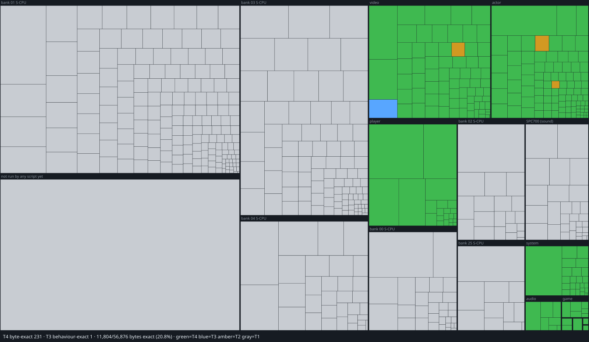

# Aladdin (SNES) decompilation

A bit-exact decompilation of Aladdin (USA) for the Super NES: symbolic,
commented 65816 and SPC700 assembly that rebuilds the ROM byte for byte,
and C for every routine, proven behaviour exact against the running
original. The C is written as C: locals, loops and tables, setting only the
registers and flags the original leaves visible at its exit, at a yield or
to a callee (`src/aladdin/include/native.h`). The sound driver's C also makes
the SPC700's memory accesses in the original's order, as lockstep requires.
The ROM is not included; `reference/aladdin/` holds your own copy.

Standard, layout and tools: [docs/aladdin/DECOMP.md](docs/aladdin/DECOMP.md).
Plan and status: [docs/aladdin/PLAN.md](docs/aladdin/PLAN.md). Findings:
[docs/aladdin/HANDBOOK.md](docs/aladdin/HANDBOOK.md).

## Progress

<!-- PROGRESS:BEGIN: generated by tools/aladdin/progress.py; do not edit by hand -->
_Snapshot 2026-11-02._

```
M1  Behaviour exact (T3 + T4)
    ████████████████░░░░░░░░░░░░░░░░░░░░░░░░   41.0%   29,730 / 72,522 B of the game's code
M2  Byte exact (T4)
    ████████████████░░░░░░░░░░░░░░░░░░░░░░░░   40.5%   29,356 / 72,522 B of the game's code
```

The bars measure the whole game's S-CPU and SPC700 code, 72,522 B: 64,077 B the scripts have run and 8,445 B the [routine census](docs/aladdin/ROUTINE_CENSUS.md) finds that no script has run yet. Certified so far: 690 routines behaviour exact, 685 of them byte exact.

| Processor | M1: behaviour exact | M2: byte exact |
|---|---|---|
| **S-CPU (65816)** | `████████░░░░░░░░░░░░` 39.1%: 27,449/70,179 B | `████████░░░░░░░░░░░░` 38.6%: 27,075/70,179 B |
| **SPC700 (sound)** | `███████████████████░` 97.4%: 2,281/2,343 B | `███████████████████░` 97.4%: 2,281/2,343 B |
<!-- PROGRESS:END -->



<!-- PROGRESS-DETAIL:BEGIN: generated by tools/aladdin/progress.py; do not edit by hand -->
**What the bars measure.** Bytes of code, not routines. The denominator is
every S-CPU and SPC700 code byte of the game, 72,522 B: the 64,077 B the scripts
have run and the 8,445 B the routine census (`tools/aladdin/census.py`) finds
by following the code statically (calls, jumps, tables, handler pointers,
task entries, orphans) where no script has gone. The numerator is the code
bytes inside routines whose C is certified behaviour exact (T3) or whose
assembly is also byte exact (T4), for M1, and T4 only for M2. 94 routine(s)
are in the tree but not yet certified (T2).

**Why not routines.** A routine count keeps growing as the work goes on:
every entry point filed in C or reached by a new script splits code already
counted into more routines (the census now counts about 1,445, 1,146 of them
named), while the bytes stay put: tracing a new script moves bytes from
"found" to "run" and barely changes the total. Of the
ROM's 1,310,720 B, the scripts have run 61,734 B as code and read 875,485 B as data;
367,401 B have not been touched by any script. The SPC700 (sound CPU) runs
code the S-CPU uploads from ROM; the 2,343 B of it the scripts have run are
counted (folded back from APU RAM onto the uploaded ROM bytes, `tools/aladdin/spcmap.py`);
what no script has run there is not counted yet.

**Byte-exact rebuild.** Independently of the tiers, the whole ROM already
rebuilds byte for byte from source: filed, commented assembly where it
exists and the raw intake for everything else (`tools/aladdin/image.py`).
<!-- PROGRESS-DETAIL:END -->

## Build

```bash
./setup.sh
python3 tools/aladdin/build.py
python3 tools/aladdin/image.py
python3 tools/aladdin/gate.py
```
