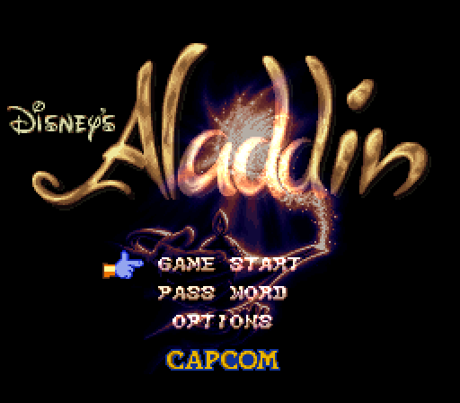
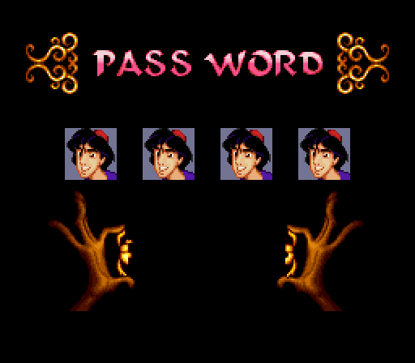
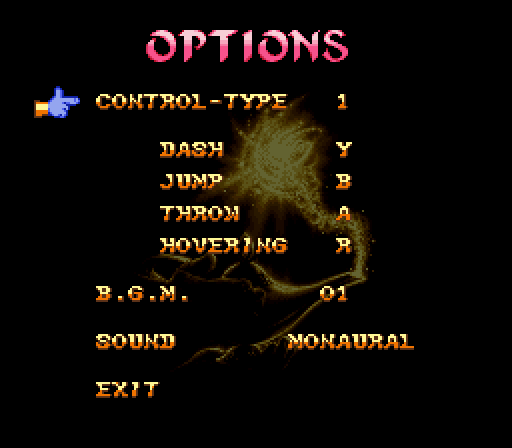
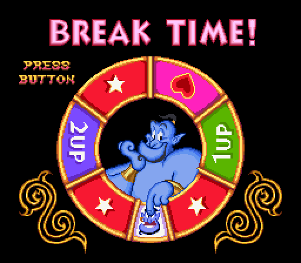
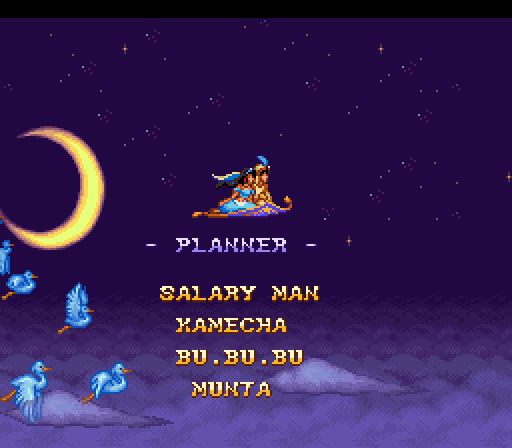

# Aladdin (SNES) decompilation

## Bring your classic game to a new generation

**Jeffrey Wilbur, Strut B, LLC** ·
[retro@strutb.com](mailto:retro@strutb.com)

If you hold the rights to a classic game, I would love to help it live
again. This repository shows what I do: I take a shipped cartridge back
to readable, commented source that rebuilds the original ROM byte for
byte, prove every routine behaves exactly as the original did, and then
run that source natively on today's hardware, with no emulation of any
processor. Here the first two are done, for every byte of the game's
code; the native game is being built now, with Linux first. From there a
game can grow: modern frame rates, widescreen, and builds for macOS,
Windows, Linux, iPhone, iPad and Android, all without losing the game
your players remember.

- **Preserve** it: source you own and can read, maintain and build on,
  recovered from the code that shipped, checked against the original at
  every step.
- **Remaster** it: modern frame rates, screens and controls, on the
  platforms your audience plays on today, with the feel of the original
  intact.
- **Reach new players**, and give your longtime fans the version they
  always pictured.

If you have a game you would like to see again, write to me at
[retro@strutb.com](mailto:retro@strutb.com).

## Aladdin

A bit-exact decompilation of Aladdin (USA) for the Super NES: symbolic,
commented 65816 and SPC700 assembly that rebuilds the ROM byte for byte,
and C for every routine, proven behaviour exact against the running
original. The C is written as C: locals, loops and tables, setting only the
registers and flags the original leaves visible at its exit, at a yield or
to a callee (`src/aladdin/include/native.h`). The sound driver's C also makes
the SPC700's memory accesses in the original's order, as lockstep requires.
The ROM is not included; `reference/aladdin/` holds your own copy.

Standard, layout and tools: [docs/aladdin/DECOMP.md](docs/aladdin/DECOMP.md).
Plan and status: [docs/aladdin/PLAN.md](docs/aladdin/PLAN.md). Findings:
[docs/aladdin/HANDBOOK.md](docs/aladdin/HANDBOOK.md).

## Progress

<!-- PROGRESS:BEGIN: generated by tools/aladdin/progress.py; do not edit by hand -->
_Snapshot 2026-11-20._

```
M1  Behaviour exact (T3 + T4)
    ████████████████████████████████████████   98.8%   91,187 / 92,250 B of the game's code
M2  Byte exact (T4)
    ████████████████████████████████████████   98.8%   91,187 / 92,250 B of the game's code
```

The bars measure the whole game's S-CPU and SPC700 code, 92,250 B: 91,064 B the scripts have run and 1,186 B the [routine census](docs/aladdin/ROUTINE_CENSUS.md) finds that no script has run yet. Certified so far: 1706 routines behaviour exact, 1706 of them byte exact.

| Processor | M1: behaviour exact | M2: byte exact |
|---|---|---|
| **S-CPU (65816)** | `████████████████████` 98.8%: 88,834/89,897 B | `████████████████████` 98.8%: 88,834/89,897 B |
| **SPC700 (sound)** | `████████████████████` 100.0%: 2,353/2,353 B | `████████████████████` 100.0%: 2,353/2,353 B |
<!-- PROGRESS:END -->

The bars read 98.7% and not 100% because on 2026-11-20 real code the count had left out (actor code the scripts never
ran, found by repairing the census) was added to it, 1,297 B at this snapshot, and is being decompiled and certified.


<!-- PROGRESS-DETAIL:BEGIN: generated by tools/aladdin/progress.py; do not edit by hand -->
**What the bars measure.** Bytes of code, not routines. The denominator is
every S-CPU and SPC700 code byte of the game, 92,250 B: the 91,064 B the scripts
have run and the 1,186 B the routine census (`tools/aladdin/census.py`) finds
by following the code statically (calls, jumps, tables, handler pointers,
task entries, orphans) where no script has gone. The numerator is the code
bytes inside routines whose C is certified behaviour exact (T3) or whose
assembly is also byte exact (T4), for M1, and T4 only for M2. 0 routine(s)
are in the tree but not yet certified (T2).

**Why not routines.** A routine count keeps growing as the work goes on:
every entry point filed in C or reached by a new script splits code already
counted into more routines (the census now counts about 1,721, 1,711 of them
named), while the bytes stay put: tracing a new script moves bytes from
"found" to "run" and barely changes the total. Of the
ROM's 1,310,720 B, the scripts have run 88,711 B as code and read 1,049,762 B as data;
172,247 B have not been touched by any script. The SPC700 (sound CPU) runs
code the S-CPU uploads from ROM; the 2,353 B of it the scripts have run are
counted (folded back from APU RAM onto the uploaded ROM bytes, `tools/aladdin/spcmap.py`);
what no script has run there is not counted yet.

**Byte-exact rebuild.** Independently of the tiers, the whole ROM already
rebuilds byte for byte from source: filed, commented assembly where it
exists and the raw intake for everything else (`tools/aladdin/image.py`).
<!-- PROGRESS-DETAIL:END -->

## The native game: Aladdin Remastered

`native/aladdin` is the game on [nativeshvc](https://github.com/jeff-strutb/nativeshvc),
a native engine, with Linux as the first platform. Each `update` is one 60 Hz
frame of the original's work; `draw` describes the picture from the game's
state. The game's C reaches the engine only through its calls (`nshvc_*`): no
register-shaped state, no translation layer and no imitated PPU, DMA, sound
chip or bus. The engine runs no processor instructions. The plan, its
decisions and its progress are in
[docs/aladdin/native/PLAN.md](docs/aladdin/native/PLAN.md); building it is in
[docs/aladdin/native/BUILD.md](docs/aladdin/native/BUILD.md).

The decomp's C (`src/aladdin`) is the certified record of what each routine
does. The native game is written from it, routine by routine, as ordinary
typed C: named state in place of memory addresses, explicit states in place
of routines that pause, and typed readers in place of cartridge addresses.
The game's logic is the original's, so a wrong value or a misplaced actor is
a bug; recordings of the original are kept to find such bugs.

### Not done

- **Not played through.** Checked by input from power-on: Start during the opening story skips it to the title; Game
  Start gives level 1, where a pad runs, jumps and throws apples (pictures below), and which does not end by itself over
  6,500 updates with no input; Pass Word and Options open from the title. Not checked: entering a password or changing
  an option, a pad's play of any level to its end, the scenes between levels. The Genie screen, the continue screen and
  the ending's credits have run only from a developer's start (not from play), and the faults seen on them are in
  `NATIVE-FAULTS.txt`: the ending's stage play-back dies after about 600 frames of a stage, level 2's first exit did not
  start with the player put at it, the level select started level 1 for two of four parts, and the four level scene
  tasks (levels 3, 5 end, $0D, $10) wait for events no run has made. None of this has been compared with the original.
- **Proven against the original only on some plays** (`NATIVE-ACTOR-CHECK.txt`: a recording of the original and the native
  game compared field by field, frame by frame). Levels: 1 (the attract demo's window, 0 of 606,824 fields differ, and
  four random plays), $04, $06, $08, $0B, $0E, $11 and $12 from passwords 1 to 7, the ending's stage 8, and stage plays
  of levels $05, $07, $09, $0A, $0C, $0D, $0F and $10. Kinds exact on some play: $00 (Aladdin, except hand-over frames),
  $08, $20, $21, $2E, $30, $34, $35, $4B, $51, $6C and $A0. Open: kind $46 with another kind in `rand_pw1_2`, $1428 on a
  platform in `rand_pw5_2`, and kinds $53 and $47 (an 85-frame stall, departure 2) with no exact play. **Never met by any
  play:** $22, $24, $44, $4E, $5C, $5D, $5F, $66, $69, $6A, $71, $84, $87, $91, $9B, $9C, $A4, $A5, $A7. Sound: the driver
  only (41 runs, 330,680 ticks, 0 differ); the sound as the engine mixes it is not sample-exact and has not been judged
  by ear.
- **The decomp's own gap.** The earlier "100%" bars left real code out: 1,533 B of reachable code in 49 runs
  (`DECOMP-GAP.txt`). Since then kinds $4C, $8B, $8C and $92 and 28 second states have been filed and the census
  repaired; still open are seven orphan runs (574 B, possibly dead), `81:D538`, `81:D5E1`, `83:FC1F`, `A5:E826`'s chain
  and 7 B. The bars above are the gate runner's and are not edited by hand.
- **Departures from the original** ([docs/aladdin/native/DEPARTURES.md](docs/aladdin/native/DEPARTURES.md)), each an
  accident the native game leaves out because it does not hurt play: a ledge that faces the wrong way no longer clears
  the fraction of Aladdin's speed (no play reaches it); the platform course maker's 85-frame stall at level $05's start;
  and a carrier-pair sender keeps its own kind.
- **The story card** copies code as graphics only with an act past 7, in one poked run (black on every frame);
  whether real play reaches it is open in the plan.
- **Platforms:** Linux only, run headless and in a window under a Vulkan translation driver. Nothing is packaged.
- **The enhanced game** (widescreen, higher frame rates) is not designed yet.

### Progress (2026-11-20)

The conversion began on 2026-11-19. Four accounts list every routine of the record's actors, game and level code,
player and video as converted, merged into other native code, replaced by the engine, dead (with the proof) or open
(`build/aladdin/writers/NATIVE-ACCOUNT-*.txt`, `native/aladdin/src/audio/ROUTINES.md` for the sound):

| Account | Routines | Converted | Merged | Replaced | Dead | Open |
|---|---:|---:|---:|---:|---:|---:|
| Actors | 950 | 662 | 210 | 0 | 76 | 2 |
| Game, level, map, system, input | 302 | 242 | 23 | 2 | 35 | 0 |
| Player | 129 | 108 | 4 | 0 | 17 | 0 |
| Video | 226 | 148 | 51 | 1 | 26 | 0 |
| **The four** | **1,607** | **1,160** | **288** | **3** | **154** | **2** |

Sound's 44 routines and math's 4 (one converted, three dead) are accounted for in their own notes: 1,655 in all. The
2 open routines are kind $92's second state and kind $8C's wait, which the record had no code for when the account was
written; the record has gained 47 actor routines since (the gap work above), so it now holds 1,702.

By the count of the record's `@routine` addresses that have a native `@routine` in `native/aladdin/src` (merged and dead
routines are not in it, so it reads lower than the accounts):

| Area | With a native routine | |
|---|---:|---:|
| Actors | 665 of 997 | 67% |
| Video | 148 of 226 | 65% |
| Game screens | 95 of 129 | 74% |
| Player | 104 of 129 | 81% |
| Level | 62 of 65 | 95% |
| Map | 44 of 65 | 68% |
| Sound | 30 of 44 | 68% |
| System, input, math | 30 of 47 | 64% |
| **Total** | **1,178 of 1,702** | **69%** |

That is 53,948 lines of native C and headers in 348 files. The engine's hardware finder and the project's clean check
(`native/aladdin/tools/clean_check.py`) report nothing in them.

What runs, on Linux, from power-on with no input: the copyright card, the logo, the opening story with its scenes and
text, the title with its menu and music, and the attract demo, which loads level 1 and plays it: Aladdin runs and jumps
through the market with Abu, past the stall keepers and the guards. By the original pad's keys from the title: Game Start
into level 1, played, the Pass Word screen and the Options screen. By a developer's start at a screen
(`ALADDIN_DEV_SCREEN`, [docs/aladdin/native/CHECK.md](docs/aladdin/native/CHECK.md), not the game's way in): the Genie's
Break Time, the continue screen and the ending's credits.

| | |
|---|---|
| <br>The opening story: the Cave of Wonders | <br>The title and its menu |
| <br>Pass Word, from the title by Down and Start | <br>Options, from the title by two Downs and Start |
| <br>Game Start into level 1, played by keys: Aladdin running, two apples thrown (the attract demo plays the same level with no input) | <br>The continue screen, reached by the developer's start (`continue`), not by play |
| <br>The Genie's Break Time, reached by the developer's start (`genie`), not by play | <br>The ending's credits, reached by the developer's start (`credits`), not by play |

The pictures are the engine's own, taken from a headless run of this repository's Linux build (`--shots`, keys replayed
with `--input`) at the console's size and doubled.

## The Decompilation Standard

The purpose of a decompilation, as opposed to a recompilation, is
preservation: recovering the game itself, as written, in a form that outlives
the original hardware and media. Playability and portability are welcome side
effects, not the direct goal. This game was written by hand in assembly, so
there is no original compiler to match. The standard has two proofs instead:
the symbolic assembly must rebuild the original ROM byte for byte, and every
routine's C must give exactly the original's outputs for its inputs, checked
call by call and again with whole play sessions run in step with the original.
A bit-exact match is 100% reliability that the source is accurate to the
original, ensuring preservation for future generations.

## Project Purpose

A decompilation of **Aladdin** (SNES, 1993): every routine rewritten as
readable C, documented with what it does and how, filed by what it is for,
and proven to behave exactly like the original; and the whole ROM rebuilt byte
for byte. Progress is measured only by those two proofs; playability is a
consequence, never a reason to reorder the work.

## Game background

Capcom released *Aladdin* for the Super NES in 1993, a platform game based on
Disney's 1992 film. It is a different game from the Aladdin made for the Sega
Genesis the same year. The cartridge is 1.25 MB of ROM with no coprocessor and
no cartridge RAM. The game runs on two processors: the SNES CPU (a 65816) runs
the game logic, and the SPC700 sound CPU plays the music and effects from a
program the main CPU uploads. The retail ROM has no compiler footprint: both
programs were written by hand in assembly. Its tasks and actors are
coroutines that wait in the middle of a routine and resume there on a later
frame ([docs/aladdin/TASKS.md](docs/aladdin/TASKS.md),
[docs/aladdin/ACTORS.md](docs/aladdin/ACTORS.md)).

## Build

```bash
./setup.sh
python3 tools/aladdin/build.py
python3 tools/aladdin/image.py
python3 tools/aladdin/gate.py
```
